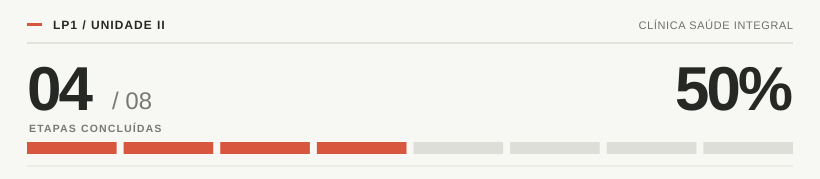

# Clínica Saúde Integral | Progresso da Unidade II

<!-- PROGRESSO-INICIO -->
**Progresso: 50%** · 4/8 tarefas concluídas
<!-- PROGRESSO-FIM -->

## Checklist

- [x] Organizar pacotes e classes abstratas
- [x] Criar Médico, Dentista e Fisioterapeuta
- [x] Adaptar o cadastro de profissionais
- [x] Listar profissionais por categoria
- [ ] Finalizar buscas e agendamentos
- [ ] Implementar a interface `Atendivel`
- [ ] Criar histórico recursivo de consultas por paciente
- [ ] Testar e corrigir o sistema
