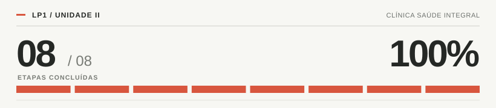

# Clínica Saúde Integral | Progresso da Unidade II

<!-- PROGRESSO-INICIO -->
**Progresso: 50%** · 4/8 tarefas concluídas
<!-- PROGRESSO-FIM -->

## Checklist

- [x] Organizar pacotes e classes abstratas
- [x] Criar Médico, Dentista e Fisioterapeuta
- [x] Adaptar o cadastro de profissionais
- [x] Listar profissionais por categoria
- [X] Finalizar buscas e agendamentos
- [X] Implementar a interface `Atendivel`
- [X] Criar histórico recursivo de consultas por paciente
- [X] Testar e corrigir o sistema
